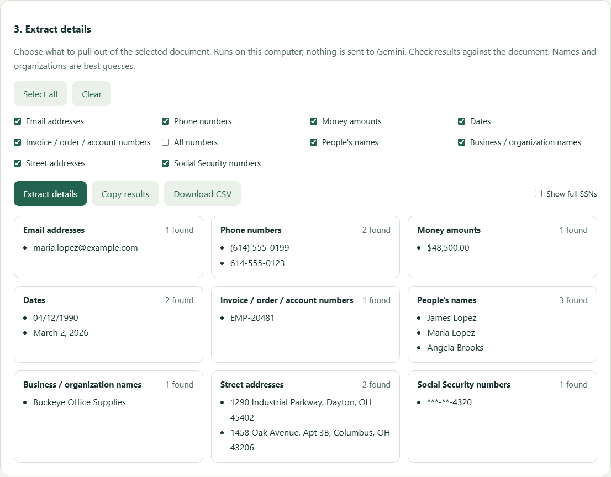
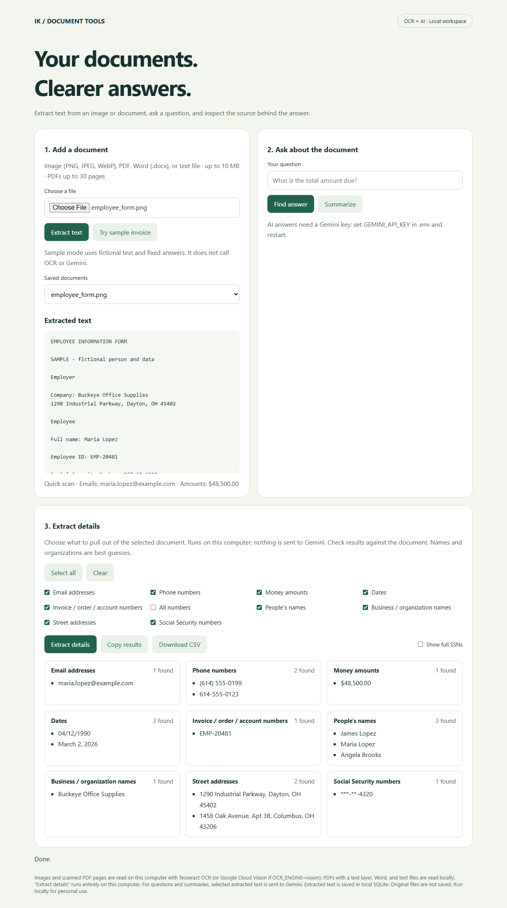
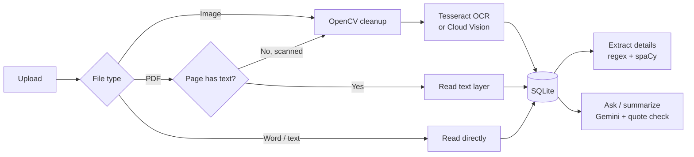

# OCR Search Engine

Built by Isiaka Kebe.

[](https://github.com/superkebe/OCR-Search-Engine/actions/workflows/tests.yml)


[](LICENSE)

Turn images, PDFs, and Word documents into searchable text, then pull out exactly the details you need: emails, phone numbers, dates, amounts, addresses, names, or Social Security numbers. OCR and detail extraction run entirely on your own computer. Optional Gemini integration answers questions about a document and shows the source quotes behind every answer.



## Features

- **Many input formats.** PNG, JPEG, and WebP images; PDFs (up to 30 pages); Word `.docx`; and plain text. PDFs that already contain text are read directly, so only scanned pages go through OCR.
- **Local OCR.** [Tesseract](https://github.com/tesseract-ocr/tesseract) by default, no account or key needed. Google Cloud Vision is available as an option. Images are cleaned up with OpenCV first (orientation, grayscale, smoothing).
- **Choose what to extract.** Tick any of 10 detail types: emails, phone numbers, money amounts, dates, invoice/order/account numbers, all numbers, people's names, organizations, street addresses, and SSNs. Copy the results or download them as CSV.
- **Privacy by default.** SSNs are masked on screen (`***-**-4320`) until you choose to reveal them. Extraction never leaves your machine.
- **Questions with evidence.** Ask "What is the total due?" and Gemini answers using only the document, citing verbatim quotes. Answers whose quotes can't be found in the text are rejected.
- **REST API.** Every feature is available over a documented FastAPI API, served over HTTPS on localhost.
- **Tested.** 17 automated tests run on every push, including one against the real Tesseract engine.

<details>
<summary>Full-page screenshot</summary>



</details>

## How it works



## Tech stack

| Area | Tools |
|---|---|
| Web API and UI | FastAPI, Uvicorn (HTTPS), vanilla HTML/JS |
| OCR and images | Tesseract (pytesseract), Google Cloud Vision (optional), OpenCV, Pillow |
| Documents | pypdfium2 (PDF), python-docx (Word) |
| Detail extraction | Regular expressions, spaCy `en_core_web_sm` |
| AI answers | Google Gemini (`google-genai`) with structured output |
| Storage | SQLite |
| Testing and CI | pytest, GitHub Actions |

## Quick start

**Requirements:** Python 3.11 or newer, and Tesseract OCR.

1. **Install Tesseract.**
   - Windows: `winget install UB-Mannheim.TesseractOCR`
   - macOS: `brew install tesseract`
   - Ubuntu/Debian: `sudo apt install tesseract-ocr`

2. **Set up the project.**

   ```bash
   git clone https://github.com/superkebe/OCR-Search-Engine.git
   cd OCR-Search-Engine
   python -m venv .venv
   source .venv/bin/activate        # Windows: .venv\Scripts\activate
   python -m pip install -r requirements.txt
   cp .env.example .env             # Windows: copy .env.example .env
   ```

3. **Run it.**

   ```bash
   python app/main.py
   ```

   Open **https://127.0.0.1:8000/**. On first start the app creates a self-signed certificate in `certs/`, so the browser warns once: choose **Advanced**, then **Continue**. API documentation is at https://127.0.0.1:8000/docs.

4. **Try it.** Upload any file from [`samples/`](samples/), then use **Extract details**.

### Optional: AI questions and summaries

Create a free key at [Google AI Studio](https://aistudio.google.com/apikey), put it after `GEMINI_API_KEY=` in `.env`, and restart. Never commit `.env`; it is already in `.gitignore`.

### Optional: Google Cloud Vision instead of Tesseract

Set `OCR_ENGINE=vision` in `.env`, enable the Cloud Vision API (with billing) in a Google Cloud project, and set up credentials with `gcloud auth application-default login` or `GOOGLE_APPLICATION_CREDENTIALS`.

### Configuration

| Variable | Default | Purpose |
|---|---|---|
| `OCR_ENGINE` | `tesseract` | `tesseract` (local) or `vision` (Google Cloud) |
| `TESSERACT_CMD` | auto-detected | Path to `tesseract` if it is not on PATH |
| `TESSERACT_LANG` | `eng` | Tesseract language code(s), e.g. `eng+fra` |
| `GEMINI_API_KEY` | none | Enables questions and summaries |
| `GEMINI_MODEL` | `gemini-2.5-flash` | Gemini model to use |
| `OCR_DB` | `documents.sqlite3` | Where extracted text is stored |

## Sample documents

[`samples/`](samples/) holds fictional test documents in every supported format: a coffee-shop receipt (PNG), an invoice (PNG, text PDF, and scanned PDF), an office-supply invoice (Word), a grocery receipt (text), and an employee form with a name, address, and SSN (PNG). All businesses, people, and numbers are made up; the SSN 987-65-4320 is from the range reserved for examples. Regenerate them with `python samples/generate_samples.py`.

## API

| Method | Route | Description |
|---|---|---|
| `POST` | `/api/documents` | Upload a file (multipart `file`); returns the extracted text |
| `GET` | `/api/documents` | List saved documents |
| `GET` | `/api/documents/{id}` | Get one document's text |
| `GET` | `/api/fields` | List the detail types that can be extracted |
| `POST` | `/api/extract` | Extract chosen details: `{"document_id": "...", "fields": ["emails", "ssns"]}` |
| `POST` | `/api/ask` | Ask a question: `{"document_id": "...", "question": "..."}` |
| `POST` | `/api/summarize` | Summarize a document: `{"document_id": "..."}` |
| `GET` | `/api/health` | Status, and whether Gemini is configured |

```bash
curl -k -F "file=@samples/employee_form.png" https://127.0.0.1:8000/api/documents
curl -k -H "Content-Type: application/json" \
     -d '{"document_id":"ID_FROM_UPLOAD","fields":["names","addresses","ssns"]}' \
     https://127.0.0.1:8000/api/extract
```

## Project structure

```text
app/
  main.py            FastAPI app: uploads, OCR, PDF/Word reading, Gemini, HTTPS
  extract.py         Detail extraction (regular expressions + spaCy)
  static/index.html  Browser interface
samples/             Fictional receipts, invoices, and a form, plus their generator
tests/               pytest suite
docs/                Screenshots
```

## Testing

```bash
python -m pytest -q
```

The tests use stand-ins for Google services, so they never use API quota. They cover upload validation for every file type, scanned and text PDFs, detail extraction including SSN rules, persistence, retrieval, answer verification, and error handling. One test runs the real Tesseract and is skipped when it is not installed. GitHub Actions runs the suite on Python 3.12 and 3.14 for every push.

## Privacy and limitations

- Built for one person on their own computer: there is no login, rate limiting, or multi-user isolation. Do not expose it to the internet as-is.
- Original files are not kept, but extracted text, including any personal details, is stored **unencrypted** in `documents.sqlite3`. Stop the server and delete that file to clear everything.
- With a Gemini key, the question and relevant parts of the document text are sent to Google. OCR and detail extraction never leave your computer (unless you choose Cloud Vision).
- Name and organization detection uses a small general-purpose language model; treat results as suggestions. Addresses and phone numbers follow US formats.
- Gemini's quote check confirms each quote exists in the document, not that every sentence of the answer is correct.

## License

[MIT](LICENSE) © 2026 Isiaka Kebe
